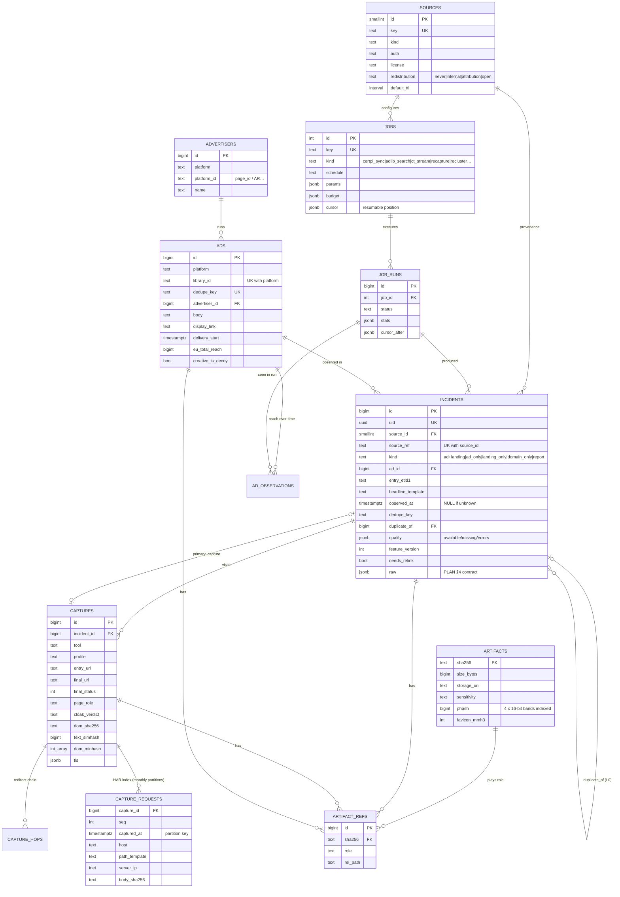
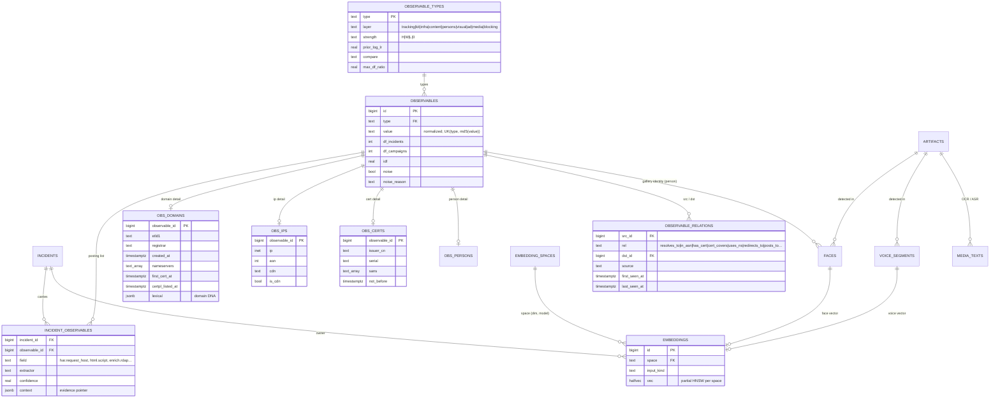
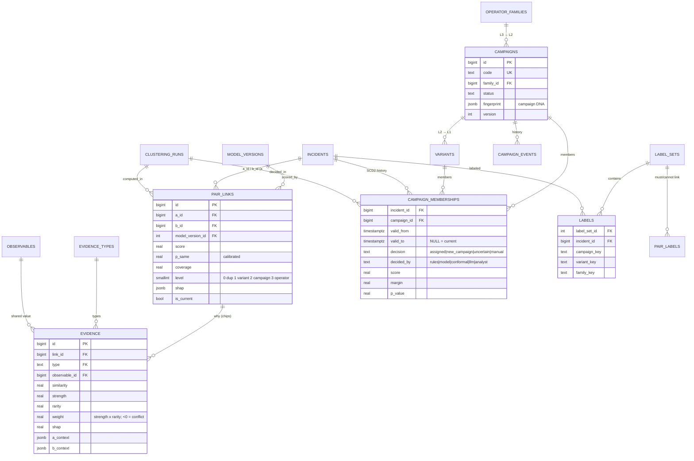
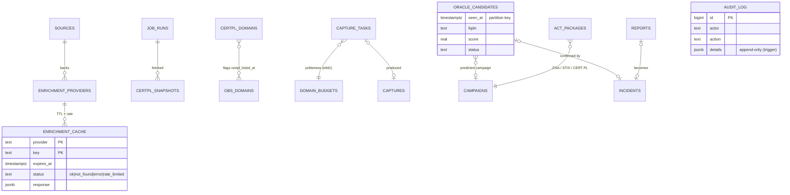

# RED PILL: database and data acquisition

> Owner: the DB & scraping stream. Covers `db/`, `scrapers/` and `docs/db/`. Status as of 2026-11-21, ~14:00.
> Companion docs: [SOURCES_FACTSHEET.md](SOURCES_FACTSHEET.md) (verified per-source facts with links) and [META_AD_LIBRARY_ACCESS.md](META_AD_LIBRARY_ACCESS.md) (step-by-step access).
> Organizer data never leaves the deployment. `data/` is git-ignored, and every row from organizer sources has `sensitivity='restricted'` and `sources.redistribution='never'`.

## 0. TL;DR

**What exists and runs**

- **Postgres 16 + pgvector + pg_trgm:** 57 tables in 9 migrations (`db/migrations/`).
  - They run automatically on first boot and are idempotent through `db/migrate.py`.
  - Verified on an empty database twice.
- **One ingest path for every source.**
  - Adapters only produce `IncidentDraft`s. A single `Loader` writes them, idempotently.
  - Adapters exist for:
    - the sample_v1 folder layout;
    - the organizer *archive bundle* layout (directory or zip);
    - our own capture, which writes the same bundle layout;
    - the Meta Ad Library API;
    - the Google Ads Transparency Center (BigQuery).
- **Seed:** `python db/seed_sample.py` loads all 15 sample incidents in about 35 s.
  - p2 is detected as an exact duplicate of p1 (L0).
  - Verified labels come from `experiments/labels.yaml`, and ad fields from `experiments/ad_truth.yaml`.
- **Enrichment:**
  - CERT PL list sync: 126,597 domains, 12 s, then conditional 304s.
  - crt.sh, with Cert Spotter as fallback.
  - RDAP through the IANA bootstrap.
  - DNS, plus Team Cymru for ASNs.
  - Everything is cached in `enrichment_cache` with per-provider TTLs and token buckets, and an offline replay mode.
- **Capture:**
  - Headless Playwright with victim-context profiles writes the organizer-compatible bundle plus extensions, and `--ingest` loads it.
  - Tested on example.com, on a 302 redirect, and on one sample domain (expired and parked, so low risk; §4.7).
- **Rarity, blocking and pivots are SQL functions:**
  - `refresh_observable_stats()`, `idf_of()`, `blocking_candidates()` (3.6 ms per incident), `infra_pivot()`, `incident_neighborhood()`.
  - `set_membership()` keeps a temporal (SCD2) campaign membership history.

**What the data model already reveals on sample_v1** without any ML: §2. Highlights:
- Kit A's 5 domains were bought at one registrar in **two registration batches** (two of them 6 s apart).
- They sit behind **one Cloudflare account** (the same NS pair).
- They got their certificates 30 min after registration.
- **10 of the 13 landing domains are still not on the CERT PL list**, 6 weeks later.

```bash
docker compose -f db/docker-compose.yml up -d            # Postgres on 127.0.0.1:55432
python -m venv .venv && .venv/Scripts/pip install -r scrapers/requirements.txt && .venv/Scripts/python -m playwright install chromium
python db/seed_sample.py                                 # migrations + sample_v1 + labels
python -m scrapers.enrich.certpl                         # CERT PL mirror
python -m scrapers.enrich                                # DNS/ASN + RDAP + crt.sh for every landing domain
python -m scrapers.capture https://example.com --ingest  # capture → bundle → incident
```

---

## 1. Data model

### 1.1 Principles

1. **Provenance on every row.**
   - Anything that came from outside carries `(source_id, run_id, source_ref)`.
   - `sources` is the source matrix, stored as data: auth, licence, a `redistribution` class, and a default TTL.
   - `job_runs` record every hunter, list sync and enrichment run, with stats and cursors.
2. **Incident is the unit of clustering.**
   - An incident is one observation handed to us: a sample folder, a hunter hit, an extension report.
   - *Ads* (deduplicated by platform and library ID) and *captures* (one browser visit each) are separate entities that incidents point to.
   - The same ad seen twice gives two incidents and one ad. The same landing visited with two profiles gives one incident and two captures.
3. **Features live in an inverted index.**
   - Every feature that matches by exact value or template (domain, pixel, kit tenant, cert, headline template, and so on) is a typed row in `observables (type, value)`.
   - `incident_observables` is its posting list.
   - The same structure gives us:
     - **blocking:** candidate pairs come from shared postings, so there is no O(n²) all-pairs comparison;
     - **rarity:** `df` and `idf` per value, plus `df_campaigns`, the spread across campaigns, as a noise detector;
     - **explanations:** each posting stores `field` and `context`, which is the pointer behind an evidence chip;
     - **pivots:** the agent and the investigation canvas walk it.
4. **Two graphs, kept apart.**
   - Incident ↔ observable is the evidence graph.
   - `observable_relations` (domain→IP, IP→ASN, cert→SAN, domain→NS, redirects, posts_to…) is the infrastructure graph.
     - It doubles as our **own passive DNS**, because `first_seen` and `last_seen` are kept per edge.
   - Enrichment facts become incident features through `Loader.propagate()`, which is time-windowed for certificates.
5. **Missing is not different.**
   - Every absent layer is stated explicitly in `incidents.quality` (available / missing / errors).
   - Evidence contributes 0 for a missing field, and `pair_links.coverage` stores how much was comparable.
6. **Blobs are content-addressed.**
   - `artifacts` is keyed by sha256 and stored at `sha256/aa/bb/<sha>` in S3 or a local FS.
   - `artifact_refs` holds the *role* of each blob (one blob can have many roles), so identical blobs deduplicate across sources.
7. **History is never overwritten.**
   - Campaign membership is temporal: `valid_from` / `valid_to`, plus `campaign_events`.
   - Pair links are versioned by `model_version_id`, and `audit_log` is append-only, enforced by a trigger.
8. **Reference data is data.**
   - Observable types, their strength priors (Fellegi–Sunter log(m/u)), evidence types, embedding spaces, provider TTLs and rate limits, and the default jobs are all rows.
   - New features, models and sources therefore need no code change in the schema.

### 1.2 ER diagrams

**Provenance and core records**



**Features: observables, relations, vectors, media**



**Analysis: evidence, campaign levels, history, feedback**



**Operations: enrichment, capture queue, Oracle, Act, citizen layer, audit**



### 1.3 Table rationale (the non-obvious decisions)

**`incidents.raw`**
- Stores the PLAN §4 Incident JSON exactly as the adapter produced it.
- The API can serve it directly, and re-extraction can replay it.
- The normalized columns and tables are the queryable truth.

**`incidents.dedupe_key` + `duplicate_of`**
- `dedupe_key` is a sha256 over the sorted *core* blobs: ad screenshot, HAR, saved/rendered page, full screenshot.
- `Loader.mark_duplicates()` handles the subset case: p2 = p1 minus the organizer bundle, so p2 → p1.
- Duplicates stay as incidents (they are separate reports). They are excluded from df counts and from blocking, so a duplicate cannot inflate a value's rarity.

**`captures` as a separate table**
- Cloaking makes "the landing" a function of who visits.
- Each capture stores:
  - `profile`, `user_agent`, `referer` and `egress`;
  - `cloak_verdict` (served / cloaked / blocked / error);
  - `page_role` (prelander / offer / order_form / decoy / error / parked).
- The incident's `primary_capture_id` is the first *served* capture.

**`capture_requests`**
- Queryable index of the HAR: host, templated path, server IP and body sha256. The HAR itself stays in object storage.
- Range-partitioned by month (`ensure_month_partition()` also moves rows out of the DEFAULT partition) so retention is `DROP PARTITION`.

**`artifacts.phash_b0..b3`**
- Multi-index hashing: two 64-bit pHashes within Hamming distance ≤ 3 must share at least one 16-bit band (pigeonhole).
- Near-duplicate screenshot search is therefore 4 btree lookups plus `hamming64()`, not a scan.
- Our pHash reproduces `imagehash`'s bit order without numpy/scipy, so values agree with the experiments code.

**`observables` unique on `(type, md5(value))`**
- Long templates would exceed the btree row limit, so the index uses `md5(value)`.
- `ON CONFLICT (type, md5(value))` works for upserts.
- `noise` / `noise_reason` are set in two places:
  - statically at extraction: CDN edge IP ranges, platform hosts (facebook.net, gstatic…), public CDN libraries (jquery…), Cloudflare-injected `/cdn-cgi/` paths;
  - statistically by `refresh_observable_stats()`, when df/N exceeds `max_df_ratio` **and** the value appears in ≥ 3 campaigns.
- Analysts can toggle noise too, through `feedback` with `verdict='noise'`.

**`df_campaigns`**
- A value carried by 100 incidents of *one* campaign is still a strong signal.
- A value spread over 30 campaigns is shared infrastructure.
- Plain idf cannot tell these apart; the cross-campaign spread can.

**Typed detail tables (`obs_domains`, `obs_ips`, `obs_certs`, `obs_persons`)**
- Class-table inheritance: enrichment lands on the entity once, not on every incident.
- `obs_domains.lexical` is the domain DNA the Oracle needs.

**Certificate identity**
- `cert` = `issuer_cn/serial`, so a precertificate and its final certificate are one entity.
- `cert_batch` = `issuer|hour` is a blocking key. The evidence engine still computes the real time window.

**`embeddings`**
- One table for all spaces, using un-dimensioned `halfvec`.
- Every space gets a *partial* HNSW index with a cast (`(vec::halfvec(768)) … WHERE space = '…'`), the pgvector pattern for mixed dimensions.
- Adding a model is one `INSERT` plus one `CREATE INDEX`.
- `halfvec` halves storage at no practical recall cost. HNSW on halfvec indexes up to 4,000 dims, so larger Qwen3-Embedding variants must be MRL-truncated.

**`pair_links` + `evidence`**
- `pair_links` is one row per surviving candidate pair per model version: score, `p_same`, coverage, level, SHAP.
- `evidence` holds the typed items behind it, with strength, rarity, weight, per-item SHAP, and both sides' context pointers.
- This is exactly what the UI's evidence chips and "why not linked" view need (see `docs/design/README.md` §7).

**`campaign_memberships` (SCD2)**
- `set_membership()` closes the current row, opens a new one, writes `campaign_events`, and bumps `campaigns.version` and `n_members`.
- "What did campaign X look like on Tuesday?" is therefore a `WHERE valid_from <= t AND (valid_to IS NULL OR valid_to > t)`.

**Labels**
- `labels` carries all four levels: campaign, variant, family and `duplicate_of_ref`.
- `pair_labels` holds must-link and cannot-link pairs for M1 training and evaluation.
- `label_sets.kind` separates ground truth, weak (labelling functions), analyst and synthetic labels.

**`enrichment_cache`**
- Also caches *negative* results, so a flaky crt.sh is not hammered.
- `REDPILL_OFFLINE=1` replays from it, for a judge machine without network.

### 1.4 Feature catalogue → storage

**Strength and IDF**
- Prior = log-LR before calibration.
- IDF is applied at query time against the current N (`idf_of()`), so cached values never go stale.

| PLAN §5 feature | Storage | Type(s) / column | Strength |
|---|---|---|---|
| FB / Google / TikTok / other pixel IDs | observable | `fb_pixel`, `google_tag` (AW-/G-/GTM-/UA-), `tiktok_pixel`, `tracker_id` (ym:/hotjar:/clarity:) | H |
| CAPI / serverless gateway | observable | `capi_gateway` | H |
| Meta campaign / ad set / ad IDs leaked in the click URL | observable | `meta_campaign_id`, `meta_adset_id`, `meta_ad_id` | H |
| TDS campaign key (Keitaro `key=`) | observable | `tds_key` | H |
| Kit tenant and lander IDs (**the experiments session's correction**: kit endpoints are platform-level, the tenant is the operator) | observable | `kit_tenant` (H), `lander_id` (H), `kit_endpoint` (**M**) | |
| Static lander directory / URL parameter grammar | observable | `lander_path`, `url_param_schema` | M |
| Asset body hashes (HAR bodies and saved `_files`) | observable + `capture_requests.body_sha256` | `asset_sha256` (public CDN libraries flagged noise) | H |
| Favicon | observable + `artifacts.favicon_mmh3` | `favicon_mmh3` | M |
| Third-party stack / third-party accounts | observable | `third_party_host` (L), `third_party_account` (H, e.g. `pandavideo:vz-<library id>`) | |
| Kit behaviour signatures | observable | `html_signature` (hue-rotate anti-hash, back-button hijack…) | L |
| eTLD+1 / FQDN / domain grammar | observable + `obs_domains` | `etld1`, `fqdn`, `domain_pattern` | H, H, M |
| Certificate / certificate batch | observable + `obs_certs` | `cert`, `cert_batch` | H, M |
| Registration batch / NS set / registrar | observable (propagated from RDAP) + `obs_domains` | `registration_batch`, `ns_set`, `nameserver`, `registrar` | M, M, L, L |
| IP / ASN (CDN-aware) | observable + `obs_ips` | `ip` (CDN edges = noise), `asn` | M, L |
| Headline template / clickbait template | observable + `incidents.headline_template`, `ads.clickbait_template` | `headline_template`, `clickbait_template` | H, M |
| Product / contacts | observable | `product`, `phone` (E.164), `iban` (checksum-valid), `email`, `telegram`, `crypto_wallet` | H |
| Persons / brands | observable + `obs_persons` | `person`, `brand` | M, L |
| Advertiser / display link | `advertisers`, `ads` + observable | `ad_page_id`, `advertiser_name`, `ad_display_link` | M, L, L |
| Operator naming leaks (`ad_name=FARM/PL/…`) | observable | `ad_naming` | M |
| Text / DOM near-duplicates | `captures.text_simhash`, `dom_minhash` + blocking observables | `lsh_text`, `lsh_dom` (strength 0 = blocking only) | — |
| Screenshot / creative pHash | `artifacts.phash` (+ bands) | `phash_band` (blocking only) | — |
| Semantic text / image / face / voice | `embeddings` (spaces registered in `embedding_spaces`) | mmlw-roberta-base 768, bge-m3 1024, Qwen3-Embedding-0.6B 1024, SigLIP-B/16 768, ArcFace 512, ECAPA 192, M2 512 | — |
| Faces, deepfake score, voice, ASR, OCR | `faces`, `voice_segments`, `media_texts` | person linked through the gallery | — |

**First-class vectors** follow the models the experiments session actually runs (`experiments/rp/emb.py`): mmlw, bge-m3, Qwen3-Embedding-0.6B and SigLIP-base. `experiments/RESULTS.md` did not exist yet when this was written. Once it lands, drop the spaces that lose and keep their indexes from wasting RAM.

### 1.5 Dedupe keys

| Entity | Key | Notes |
|---|---|---|
| artifact | `sha256` | Content-addressed; the same jquery or hero image across sources is one blob |
| ad | `platform:library_id`, else `shot:<sha256 of screenshot>`, else `text:<sha256(norm body \| advertiser)>` | Partial unique index on `(platform, library_id)` |
| advertiser | `(platform, platform_id)`, else `(platform, lower(name))` | Two partial unique indexes |
| incident | `(source_id, source_ref)` unique, plus the `dedupe_key` / subset rule for L0 | Re-ingesting the same ref updates in place and bumps `feature_version` |
| capture target | `normalize_url()`: lower host, drop fragment, click IDs (fbclid, gclid…) and `utm_*`, sort the query | `capture_tasks` has a unique `(url_norm, profile)` among queued/running rows |
| observable | `(type, normalized value)` | Normalizers: IDNA/lower domain, canonical IP, E.164 phone, IBAN without spaces and checksum-valid, lower-hex serial, path templates (`{uuid}`, `{int}`, `{hex}`, `{tok}`) |
| relation | `(src_id, rel, dst_id)` | `first_seen` / `last_seen` updated in place |
| enrichment | `(provider, key)` | |
| CERT PL | `domain` | `first_seen_at` = `InsertDate`, `removed_at` = `DeleteDate` |
| oracle candidate | `(fqdn, seen_at)` | Monthly partitions |

### 1.6 Incomplete data

`incidents.quality` lists what is present, what is missing and what went wrong. Real examples from the sample:
- `{"errors":[{"landing":"error","title":"<domain> | 502: Bad gateway"}]}` for the p1 bundle.
- `video_deleted` for p10.
- `missing: ["landing_har","observed_at"]` for p6.

Rules:
- **An unknown time stays NULL.** The capture row needs a timestamp (partition key), so it gets the ingest time with `meta.captured_at_source='ingest_time'`, and `incidents.observed_at` stays NULL.
- **An error, blocked or parked capture never becomes primary.**
  - Its page text and screenshot are not used for content or visual evidence. The M5 page-role model drops visual weight.
  - Its infrastructure (DNS, TLS, IPs, cert) *is* used. A 502 behind Cloudflare still tells you the domain, the cert batch and the registration batch.
- **Missing scores 0, not negative.**
  - A missing layer contributes 0, and `pair_links.coverage` records how many layers were comparable.
  - Negative evidence (`conflict_tracking`, `conflict_kit`) applies only when both sides have that layer and nothing overlaps.

### 1.7 Incremental re-clustering

```
new/changed incident ─► loader sets needs_relink=true, feature_version++
                     ─► enrich jobs (dns/rdap/crtsh) propagate infra observables → needs_relink again
relink worker (every 5 min, or on event) for each dirty incident:
  1. candidates = blocking_candidates(id)            # shared rare postings, < 5 ms
               ∪ HNSW kNN per active embedding space  # pgvector, iterative scan for filters
               ∪ pHash band lookups                   # multi-index hashing
  2. compute evidence + pair_links with the active model version (upsert; old version is_current=false)
  3. local subgraph = dirty incident + candidates + current members of their campaigns (bounded, e.g. 2k nodes)
  4. Louvain on the local subgraph, warm-started from current memberships
  5. reconcile new clusters ↔ existing campaign ids by max Jaccard overlap (Hungarian):
       overlap ≥ 0.5 → same campaign id; otherwise new campaign(status=candidate) / merged / split
       → campaign_events (merged/split/created)
  6. open-set decision for incidents not absorbed: score vs. each campaign (max-linkage + mean top-3),
     conformal p-value, τ / δ → set_membership(decision = assigned | new_campaign | uncertain)
  7. refresh_observable_stats(since=batch_start)     # incremental df/idf/df_campaigns
  8. needs_relink=false; clustering_runs row with metrics
nightly: full refresh_observable_stats() + full re-cluster; ARI(incremental, full) is logged as a drift alarm
```

### 1.8 Graph traversal: recursive CTEs vs. graph export

**Interactive pivots** (the agent's tools, the investigation canvas, "show infrastructure around X") use bounded recursive CTEs:
- `infra_pivot(seed, depth, fanout)` walks `observable_relations`.
  - It has path-based cycle protection and never enters noise nodes.
  - L-strength hubs (registrar, ASN, shared NS) are reached but not expanded.
- `incident_neighborhood(seed, depth, max_df)` walks the bipartite incident–observable graph through rare H/M values.
- Both answer in milliseconds on the sample. They stay fast at scale because hubs are capped by `max_df` and noise flags, not by data size.

**Analytics** (community detection, centrality, kit phylogeny, M2 positive pairs) export `v_graph_edges` into igraph or networkx in the worker:
- `v_graph_edges` is one unified, typed edge list: incident→observable, observable→observable, pair links, memberships and families.
- Louvain and Leiden-style algorithms do not belong in SQL.

**Neo4j and Cypher**
- An optional *export* of `v_graph_edges` as CSV (`LOAD CSV`) or GraphML for anyone who wants Bloom or Cypher.
- No dual writes; Postgres stays the single source of truth (PLAN §3).

### 1.9 Retention

| Data | Keep | How |
|---|---|---|
| Organizer data (`redistribution='never'`) | Hackathon deployment only; deleted on request | `DELETE … WHERE source_id = …` cascades, then artifact GC (blobs with no `artifact_refs`); exports filter on `sensitivity` |
| Raw blobs (HAR, MHTML, PDF, video) | 180 days hot, then cold or deleted unless the incident is labeled or in an active campaign | Object-store lifecycle rules keyed by prefix/tag; GC job |
| `capture_requests` | 6 months | `DROP` monthly partition; the HAR in the object store remains |
| `enrichment_cache` | Until `expires_at` (daily purge) | Derived facts persist in `obs_*` / relations |
| `pair_links` (not current) | 30 days | Current links and their evidence are kept |
| `oracle_candidates` | 90 days unless confirmed or labeled | Monthly partitions |
| `job_runs` | 90 days | Aggregated stats kept |
| Campaign history, labels, feedback, `audit_log` | Indefinitely | Small; `audit_log` is append-only |
| Personal data | Reporters only as a salted hash; registrant e-mails (rare after GDPR) 1 year | Purpose: fraud prevention (legitimate interest); documented in `docs/DATA_SOURCES.md` |

### 1.10 Scale to millions of ads

Rough sizes at 10 M incidents/ads, of which ~1 M have captured landings:

| Table / store | Size | Mitigation |
|---|---|---|
| `incident_observables` | 10–60 postings/incident → 100–600 M rows, ~40–80 GB with indexes | Postings of `noise` values are capped after `df` reaches a threshold (keep the counter, stop writing rows). Hash-partition by `incident_id` (16 partitions) for parallel scans; the posting index stays per partition. |
| `capture_requests` | ~40 rows × 1 M captures per 6 months = 40 M rows | Monthly partitions, dropped after 6 months |
| `embeddings` | 768-dim `halfvec` ≈ 1.5 KB → 15 GB per space per 10 M, plus HNSW | One or two "hot" spaces; HNSW only over the active window (partial index on recent rows); binary quantization + re-rank for cold data; a dedicated vector DB only past ~50 M |
| `pair_links` / `evidence` | Blocking gives ~20 candidates per incident | Keep only links above a floor plus top-k per incident; evidence only for kept links (~5 per link) |
| Object store | HAR ~3 MB, bundle ~5 MB per capture → 5 TB per 1 M captures | sha256 dedupe (shared kit assets collapse), lifecycle to cold storage, skip HLS segments unless media analysis needs them |
| Hunter ingest | Meta API pages of 100 ads | `COPY`-based bulk path, the same `Loader` |

**Throughput today:** about 0.7–3 s per sample incident, dominated by HAR parsing, MinHash and image hashing. All of it is pure Python and parallelizes per incident in arq workers.

---

## 2. What the schema already shows on sample_v1 (no ML, rules + enrichment only)

> This public version names no organizer-derived identifiers (domains, pixel IDs, tenant UUIDs, gateway hosts). The identifier-level table is in the git-ignored `data/notes/DB_FINDINGS_sample_v1.md`.

| Finding | How it shows up in the DB | Why it matters |
|---|---|---|
| Three tenants of the multi-tenant landing kit ("kit A"): one on p1/p2/p3/p4/p7/p15, one on p6+p12, one on p11 | `kit_tenant`, df = 5 / 2 / 1 | Operator level, matching `experiments/labels.yaml` exactly. Kit endpoints are shared by all three tenants, so they are platform-level (M). |
| Kit A's 5 domains were registered at one registrar in **two batches**: two domains 6 s apart on one day, three domains within 5 min two days later | `registration_batch` (p3+p4 / p1+p7+p15) | This is the A1 / A2 variant split, recovered from WHOIS-free RDAP alone |
| 4 of the 5 kit A domains share **one Cloudflare NS pair**; p6 and p12 share another | `ns_set`, df = 4 and 2 | Cloudflare assigns an NS pair per account, so this is a strong "same account" signal behind a CDN that otherwise hides everything |
| First TLS cert about **30 min after registration** (same issuer, same hour across the batch); captured 15–64 h after registration | `obs_domains.created_at`, `first_cert_at`, `cert_batch` | The Oracle's premise: the cert appears in CT within minutes of the purchase, hours before the ad |
| **Only 3 of 13** landing domains are on the CERT PL list, even 6 weeks later. They were listed 2 h, 34 h and 102 h after capture | `obs_domains.certpl_listed_at` vs `incidents.observed_at` | A measurable coverage and latency gap that campaign-level takedown packages address |
| One shared CAPI gateway and one FB pixel on p1–p4 and p7 (not p15) | `capi_gateway`, `fb_pixel`, df = 4 | **Correction from urlscan (§2.1):** the gateway is a hosted, multi-tenant Conversions-API service also used by 80+ legitimate shops, so it is now `noise='urlscan:shared_service'`. The pixel stays operator-level. |
| p8 ↔ p11: the same lander template (20+ byte-identical images) on two different stacks | `asset_sha256` df = 2 on ~20 values, `headline_template` | Asset hashes survive stack changes |
| Cloudflare edge IPs everywhere (p4/p5/p9/p10/p15 share one edge range) | `ip` with `noise_reason='cdn:cloudflare'` | Zero weight by construction |
| p2 is a byte-identical subset of p1 | `incidents.duplicate_of` | L0 dedupe on the core-blob subset rule |

### 2.2 DANE (official dataset): what loading it showed

DANE is 10 incident folders, 533 MB. It uses the same per-folder layout as sample_v1, plus formats the adapter now handles (§5). It loads in 16 s: 10 incidents, 13 captures, 321 HAR request rows, 195 stored blobs (including a 339 MB screen recording).

Links found by the inverted index plus enrichment, with no model involved:

| DANE incidents | Linked to | Through | Reading |
|---|---|---|---|
| 1, 2 | Campaign A, variant A1 (p1/p7/p15) | Same kit tenant, lander ID, FB pixel, headline template, 19 identical assets | New members of a known campaign. Their domains form a **third Dynadot registration batch** (2 min apart), and one shares campaign A's **Cloudflare account** (NS pair) |
| 2 (second landing), 3 | p5 | TDS campaign key, same **Cloudflare account** (NS pair) as p5, same NiceNIC **registration hour**, cert batch | One operator behind the Olejnik/TVN24 fake-news line |
| 48, 61 | Each other (+3 assets shared with p5) | Same headline template, 8 identical assets | One campaign; its relation to p5's operator is only supportive (assets) |
| 5, 10, 14, 36, 47 | Nothing known | — | **New-campaign candidates**: the open-set case the hidden test set rewards |

Only 2 of the 9 DANE landing domains are on the CERT PL list.

DANE 5 is a video-only ad with its Ad Library ID in the filename. Its metadata can't be fetched by ID, because the API only supports search, so it stays ad-only until it reappears in a hunter search.

### 2.1 External rarity: urlscan as a global document frequency

Inside our corpus, rarity (idf) only measures how common a value is **among our incidents**. A value can be rare for us and common on the internet, like a hosted tracking gateway or a stock photo. `scrapers/enrich/urlscan.py` therefore searches each pivot-worthy value in urlscan's index (search only, never submitting a scan). Pivot-worthy means non-noise and shared by ≥ 2 incidents: kit asset hashes via `hash:`, gateways and rare third-party hosts via `domain:`, and non-CDN origin IPs via `page.ip:`.

`classify_pivot()` then reads the population of sites that also use the value:

| Population | Verdict | Effect |
|---|---|---|
| ≥ 20 distinct sites, > 50 % older than 1 year, > 60 % distinct page titles | **shared service** | The value becomes noise everywhere (zero weight) |
| The same bytes on a popular, ranked site (`umbrellaRank`) | **brand asset**, e.g. a copied logo | Noise |
| Young domains, or one title repeated across hijacked sites | **campaign / kit infrastructure** | Every unseen domain becomes an `oracle_candidates` row with the pivot as its explanation, checked against the CERT PL mirror |

First run on sample_v1, which spent 40 of the free plan's 1,000 daily searches:
- **1 shared service found:** the "operator" CAPI gateway in PLAN §2 is a hosted service, with 86 sites, 78 % of them old and every title different.
- **1 brand asset found:** a copied Gazeta.pl image.
- **137 new candidate domains:**
  - **94 sites running kit A's SDK**: fake-news and "AI trading" pre-landers in about 8 languages (PL, DE, FR, ES, SK, BG, EN-AU…), seen 2026-09-24 → 11-11. Only **1** of them is on the CERT PL list. This is platform-level evidence, so the operator is unknown until a tenant ID or capture confirms it.
  - **37 sites serving the p8/p11 lander**, most of them hijacked old websites with the identical page title; **7** are on the CERT PL list.
  - **6 others.**

This is the Oracle's second input next to the CT stream, and a method point for the jury: evidence weights are calibrated by rarity in the outside world, not just in our sample.

---

### 2.3 Corpus expansion loop (`python -m scrapers.expand`, job `expand_daily`)

The organizers provide 24 unique incidents (15 sample + 10 DANE, one duplicate). The loop turns our own sources into full incidents with the same schema, extractor and evidence pointers:

| Step | What happens | First run (2026-11-21) |
|---|---|---|
| `urlscan_pivots` | Campaign values (kit asset hashes, gateways, origin IPs) → urlscan search → unseen domains → `oracle_candidates` (shared services and brand assets are filtered out, §2.1) | 40 searches → 137 candidates |
| `urlscan_results` | Each candidate's latest **public** scan (requests with body hashes, DOM, screenshot, TLS) → incident (`source=urlscan_scan`, adapter `ingest/urlscan_result.py`). We never visit the site | 137/137 loaded |
| `meta_snapshots` | Meta ads without a landing (most coordinated ad texts first) → render the ad snapshot in memory → outbound link → `ads.link_url` + link observables (`hunter/meta_snapshot.py`). The access token is never persisted | 40 rendered, 39 with a link (33 distinct landing URLs) |
| `sandbox_capture` | Landings captured in the hardened container, victim + bot profile, `--fast` bulk mode, attached to the ad's incident (`ad_only` → `ad+landing`), cloaking pairs marked | 20 ads gained landing captures; 28 served, 7 errors, 2 challenge pages |
| `enrich` / `relink` | DNS/ASN, RDAP, IPinfo (crt.sh in the daily run); `mark_platform_values()`; `refresh_observable_stats()` | — |

**Result:** 24 organizer incidents → **178 incidents with a served landing capture**, plus 1,568 ad-only incidents. The database holds 228 captures, 10,408 request rows, 1,625 blobs (2.3 GB) and is 472 MB.

**What the larger corpus changed in the method**
- **Kit A is a platform, not an operator: 18 distinct tenants.** Values seen under ≥ 3 tenants (SDK files, API paths, static directories, behaviour signatures: 29 values, up to 17 tenants each) are now marked `platform:multi_tenant` by `mark_platform_values()`. They stay queryable as "uses kit A" but carry zero campaign weight. Without this rule, the shared SDK alone would have merged 94 sites from at least 6 different operators.
- **Campaign links survive the rule:**
  - 38 urlscan sites share the p8/p11 lander template (headline + assets + gateway);
  - 6 share p9's video-hosting account and product;
  - new tenants form their own clusters, e.g. one tenant with 28 sites, and an Arabic-language template on 8 sites.
- **The pool is multilingual:** PL, EN (UK/AU personas), TR, AR, DE, FR, ES, SK, BG. The Polish narratives are one deployment of international kits.
- **Meta ad landings are mostly not the fake-news funnels.** The first 33 lead to cross-border drop-shipping shops sharing one shop template (`/index/detail.html?sno=…` on several domains) and to short-drama apps. Neither cloaks (victim and bot see the same page), so they are a different fraud family from the cloaked pre-landers.

**Operational lessons (fixed)**
- Live media streams must time out: media body 15 s, media drain 20 s, a hard cap of 240 s per capture. One stuck stream froze the container run.
- Windows bind mounts occasionally return `EIO` on large writes; the batch now skips and continues.
- NUL bytes in third-party scans are stripped before `jsonb`/`text`.
- Capture zips are named from the full bundle name, so domain dots no longer collide.

## 3. Where the data comes from: the source matrix

Verified details, links and every [CHG] (2025–2026 change) are in [SOURCES_FACTSHEET.md](SOURCES_FACTSHEET.md). In this table, "Fills" names the tables a source writes to; the verdict is for this hackathon.

| Source | What we use | Auth | Rate limit | Cost | ToS / legal | Refresh | Fills | Verdict |
|---|---|---|---|---|---|---|---|---|
| **Meta Ad Library API** (`ads_archive`, v27.0) | All EU ads: text, link title/caption, page id/name, delivery dates, EU reach, targeting, snapshot URL. **No landing URL, no media.** | Identity check (facebook.com/ID) + app + user token (60-day long-lived) | Undisclosed; error 613 = back off. Our budget: 200 calls per run, every 2 h | Free | Platform terms. API is the only allowed programmatic access. Snapshots for individual-ad analysis. EU ads kept 1 year | Every 2 h per lure job; `ad_observations` per run | `ads`, `advertisers`, `ad_observations`, `incidents(ad_only)`, observables (`ad_page_id`, `clickbait_template`, `person`…) | **Running**: identity-confirmed user token (60-day, exchanged via app id/secret). First lure-phrase run (7 terms × 3 pages, 21 calls): 1,588 ads from 734 pages, 11 M EU reach. The top clickbait template spans 208 ads on 160 different pages (throwaway-page rotation) |
| Meta Ad Library **web UI** | Manual lookups only | — | — | — | Automated collection forbidden | Manual | via Analyze screen | **Demo / manual only**; never scraped |
| **Google Ads Transparency** (BigQuery) | Advertiser id, name, verification; creative id and page URL; PL first/last shown; removal reasons | Google account (BigQuery sandbox) | 1 TiB scanned per month free | Free tier | Google ToS + ATC terms | Daily | `ads(platform=google)`, `advertisers`, weak labels from `removed_creative_stats` | **Running** in a billing-free BigQuery sandbox project (cannot be charged; 1 TB/month): 52,938 PL creatives removed in the last 30 days with Google's reasons (10,364 "Misrepresentation") + **339,073 advertisers** active in PL in the last 7 days (13,912 unverified), one row each with creative count, dates, topics and formats. Loaded as a *registry* (`ads`/`advertisers`), not as incidents. Removed creatives are absent from `creative_stats`, so their owners cannot be resolved from this dataset |
| **TikTok Commercial Content API** | EU ads: id, dates, reach, advertiser, videos/images | Application + approval (~2 working days) | Unpublished (Research API: 1,000/day) | Free | TikTok terms; eligibility for commercial users unclear | Daily | `ads(platform=tiktok)` | **Not feasible today**; documented for later |
| **CERT PL warning list** (v2) | 126k domains with insert/delete dates; NDJSON action history | None | Poll ≤ every 5 min (we use 10 min with ETag) | Free | Any use incl. commercial; must not imply endorsement | 10 min | `certpl_domains`, `certpl_snapshots`, `obs_domains.certpl_listed_at` | **Running** (`enrich/certpl.py`) |
| **urlscan.io** | Search pivots (`page.domain`, `hash:`, `page.ip`, `page.asn`, `page.tlsIssuer`, `domainAgeDays`) | Keyless search; key needed for `/result` (since 2026-05) | Anonymous 30/min and 30 days back; free account 1,000 searches/day | Free / Pro $1,250 per month | Commercial use needs permission | 30 min per saved query | `observable_relations`, `oracle_candidates(source=urlscan)` | **Running** (`enrich/urlscan.py`, keyed: 120 searches/min, 1,000/day): search-only pivots → 137 candidates (§2.1) |
| **crt.sh** (+ Cert Spotter) | All certs for `%.domain`: issuer, serial, SANs, validity | None | 5 req/min/IP; frequent 502s | Free | — | On new domain; daily for active campaigns | `obs_certs`, `cert` / `cert_batch` postings, `cert_covers` relations, `obs_domains.first_cert_at` | **Running** (`enrich/crtsh.py`): 257 certs for 14 domains |
| **Live CT stream** (self-hosted certstream-server-go incl. static-CT tiles) | Every new cert's SANs within seconds | None | Our bandwidth (~300 certs/s) | Free | CT is public | Continuous | `oracle_candidates` (only above the score threshold) | **Feasible with self-hosting**; CaliDog's public stream is dead |
| **RDAP** (IANA bootstrap) | Registrar, IANA id, created/expiry, status, NS; rarely a registrant e-mail | None | Unpublished per registry; honour 429; rdap.org 10 per 10 s | Free | GDPR-redacted; gTLD WHOIS sunset 2025-01-28 | On new domain; weekly | `obs_domains`, `registrar` / `ns_set` / `registration_batch` postings, relations | **Running** (`enrich/rdap.py`): 14/14 OK |
| **DNS** (+ Team Cymru ASN) | A/AAAA/CNAME/NS/MX/TXT; IP→ASN, prefix, CC | None | Resolver-bound | Free | — | On new domain; 6 h for active | `resolves_to` / `in_asn` / `uses_ns` relations (our passive DNS), `obs_ips` | **Running** (`enrich/dns.py`) |
| **IPinfo Lite** | Country, ASN, AS name/domain | Free token | Unlimited | Free | CC BY-SA 4.0, attribution | 30 days | `obs_ips` | **Running** (`enrich/ipinfo.py`); attribute IPinfo in the UI |
| **Shodan InternetDB** | Open ports, CPEs, hostnames, tags | None | Unstated | Free | **Non-commercial** | 7 days | `obs_ips.open_ports`, `hostnames`, `tags` | Feasible now; licence caveat for production |
| **Wayback CDX** | First/last archive of a domain or URL; earlier content | None | 429 anti-automation since 2026-09 | Free | IA terms | On demand (agent pivot) | relations, `media_texts` | Feasible, low volume |
| **OpenPhish** (GitHub feed) | Phishing URLs, 12 h | None | — | Free | **Non-commercial, no redistribution** | 12 h | `oracle_candidates(source=openphish)` | Feasible; off by default (licence) |
| **Passive DNS** (mnemonic) | Historical resolutions | None | 10/min, 1,000/day | Free | TLP:WHITE | On demand | `observable_relations` | Feasible for agent pivots |
| **User / extension reports** | URL, ad library id, screenshot, note | None (pseudonymous) | Our API rate limit | — | User-submitted; salted reporter hash only | Push | `reports` → `incidents` | Design-ready (table and adapter path exist) |
| **Organizer DANE.zip** | Unknown format (510 MB) | — | — | — | **Never publish** | Once | via an adapter (§5) | Adapter-ready: `scrapers.ingest --dry-run` on the unpacked folder will show which layout it matches |

---

## 4. Landing capture design (`scrapers/capture/`)

### 4.1 Goal
See what a *victim* sees, record everything that identifies the operator, and never act on the page. The output is a bundle in the **organizer's layout**, so our captures and theirs flow through one adapter.

### 4.2 Victim-context profiles (anti-cloaking without evasion)

Cloakers (Keitaro-type TDS, kit A) decide per visit from these signals:
- user agent;
- language;
- referrer;
- the original click parameters (`fbclid`, `utm_*`, ad IDs);
- IP reputation and geo.

`profiles.py` emulates that context:
- **`fb_inapp_android_pl`** (the default):
  - Android WebView UA with the `[FB_IAB/FB4A;FBAV/…]` token, plus `X-Requested-With: com.facebook.katana`;
  - 412×915 at 2.625 dpr, touch;
  - `pl-PL`, `Europe/Warsaw`, referer `https://l.facebook.com/`.
- `ig_inapp_ios_pl`.
- `desktop_chrome_pl`.
- **`plain_headless`**, deliberately bot-like. Capture it *next to* a victim profile: the content delta between the two captures is direct evidence of cloaking (`cloak_verdict='cloaked'`) and a feature in itself.

Only one automation tell is removed (`navigator.webdriver`). No fingerprint forgery, no stealth plugins.

**A captcha, Turnstile or "Just a moment" page is recorded as `blocked` and never solved.**

Egress:
- `--proxy` routes captures through a PL egress, so captures do not come from an analyst's IP and match the victim geography.
- Choosing the proxy provider is an open question (§8).

### 4.3 What is recorded

| Artifact | How | Notes |
|---|---|---|
| Full redirect chain | Main-frame responses + `request.redirected_from` for HTTP 3xx; later main-frame navigations = `js_navigation`, re-tagged `meta_refresh` when the previous document carried `<meta http-equiv=refresh>`; final SPA/history URL appended | `redirects.json` → `capture_hops` (entry / http_redirect / meta_refresh / js_navigation / frame / final) |
| HAR | `record_har_content="embed"`, mode `full` | All bodies inline; asset hashes and kit paths come from it |
| DOM / source | `page.content()` (rendered) + the main document response body (source) | `html/rendered.html`, `html/source.html` |
| Text | `document.body.innerText` | `page_text.txt` |
| Screenshots | Viewport + full page | pHash and bands at ingest |
| MHTML / PDF | CDP `Page.captureSnapshot`, `page.pdf()` | Evidence for DSA notices |
| Favicon | `link[rel*=icon]`, else `/favicon.ico`, fetched through the same context | `favicon.*` + `favicon.json` with mmh3 and sha256 |
| TLS cert | Python `ssl` handshake (certifi bundle), `getpeercert()` dict in the organizer's format; if verification fails, the DER is decoded anyway | `dns_ssl.json` + `ssl_der_sha256`, `tls_version`, verify errors |
| DNS | `getaddrinfo` for the final host, even when the page failed | `dns_ssl.json.all_addresses` |
| Forms / outlinks | DOM walk: action, method, field names and types | `forms.json`, `outlinks.json`. **Never submitted.** |
| Storage | Cookies, localStorage, sessionStorage (guarded: hostile origins throw) | `storage/*.json` |
| Console | Console messages, page errors, capture-internal notes | `console.json` |
| Media | Every `video/*`, `audio/*` or HLS response ≤ 60 MB; HLS playlists saved as text | `media/` + `manifest.json`. Segment download and ASR/voice belong to the media worker (ffmpeg, same profile) |
| Integrity | `sha256.json` over every file; zipped bundle + `.zip.sha256` (the organizer convention) | The ingest adapter verifies both and records mismatches in `quality.errors` |

### 4.4 Bundle layout: organizer vs. ours

| Path | Organizer (p1) | RED PILL | Ingest role |
|---|---|---|---|
| `archive_info.json` | url, timestamp_utc, title, user_agent | + tool, profile, referer, final_url, status, duration, challenge_detected, page_role_hint, error | `archive_info_json` |
| `dns_ssl.json` | hostname, ip, all_addresses, ssl | + ssl_der_sha256, ssl_verified, tls_version, errors | `dns_ssl_json` → `cert`, `cert_batch`, `ip` |
| `metadata.json`, `page_text.txt`, `html/{rendered,source}.html` | ✓ | ✓ | page text, DOM |
| `network.har` | ✓ (Playwright 1.63) | ✓ (Playwright, embedded content) | `landing_har` |
| `screenshots/{viewport,full_page}.png`, `page.pdf`, `page.mhtml` | ✓ | ✓ | |
| `storage/{cookies,localStorage,sessionStorage}.json` | ✓ | ✓ | |
| `sha256.json` | ✓ (backslash paths) | ✓ (forward slashes; both accepted) | integrity check |
| `redirects.json`, `favicon.*` + `favicon.json`, `forms.json`, `outlinks.json`, `console.json`, `media/` | — | extensions | hops, favicon, forms, media |

### 4.5 Sandbox and safety policy (enforced in code)

**In the code (`capture.py`)**
- Headless only. Chromium's own sandbox is switched on explicitly on a host (Playwright leaves it off by default); inside the container the container is the isolation layer.
- `accept_downloads=False`, and downloads are cancelled.
- Requests for `.exe`, `.apk`, `.msi`, `.zip`, `.rar`, `.iso`… are aborted at the route layer.
- Service workers are blocked.
- No clicks, typing or form submission: the page is loaded, scrolled four times and observed.
- Captchas and challenges are never solved.

**In production** (`scrapers/capture/Dockerfile`)
- The official Playwright image, run as non-root.
- `--read-only` with tmpfs, `--cap-drop ALL`, `no-new-privileges`, memory and pids limits.
- A Docker network with an egress firewall: internet or proxy only, no RFC 1918 ranges, so a hostile page cannot reach the analyst LAN.

**Enrichment** contacts only resolvers, RDAP registries and CT services, never the scam host. The TLS handshake in a capture is the one exception, and it runs only when we capture anyway.

### 4.6 Politeness

`politeness.py` keeps a per-eTLD+1 token bucket in `domain_budgets`:
- 6 captures per hour by default;
- one capture in flight per eTLD+1 at worker level;
- a circuit breaker after 3 consecutive failures: 1 h cooldown, doubling up to 24 h.

Being gentle matters beyond courtesy. Aggressive revisits get an IP flagged by the cloaker, and from then on every capture shows the decoy.

### 4.7 Tests run

**Harmless pages**
- `https://example.com/` → 200, a 19-file bundle, ingested.
- `https://httpbin.org/redirect-to?…&status_code=302` → chain `entry:302 > http_redirect:200` (example.org), TLS cert decoded (Cloudflare TLS ECC CA 3).
- Both were then deleted from the demo DB.

**One sample domain:** p14's landing domain (not named here; see the private notes).
- Why this one:
  - RDAP and DNS showed it **expired**: NS `dns-expired.com`, IP on the Hostinger parking ASN.
  - So the server we contact is the registrar's parking page, not the operator's.
  - We used the bare domain with no click parameters, headless.
- What happened:
  - The site failed the TLS handshake (`ERR_SSL_PROTOCOL_ERROR`).
  - The capture fell back to http once, got 200 "Your domain is expired", then bounced to a TLS error.
  - The bundle recorded DNS, the TLS alert, HAR and screenshots, and ingested as `page_role=error`, linked to p14 through the domain.
### 4.8 Live re-capture of the sample landings (2026-11-21)

**Setup**
- Targets: the 11 sample landing domains that still resolve (excluding one with no A record and one parked on 1.1.1.1), each requested with its original entry URL.
- Each target was captured twice: victim profile `fb_inapp_android_pl` first, then the bot profile `plain_headless` 20 s later.
- 4 sites ran in parallel with one capture at a time per site: 22 captures in about 2 minutes.
- Run from the analyst laptop at the user's request, headless with Chromium's own sandbox on. The sandbox image was still downloading.

**How the results are stored**
- `python -m scrapers.capture --ingest` attaches each re-capture to the incident with the same normalized entry URL: `Loader.add_capture()`, postings tagged `capture@1`.
- `Loader.mark_cloaking()` then compares victim/bot pairs.

| Incidents | Result | Meaning |
|---|---|---|
| p9, p10, p13 | **Cloaked**: the victim gets the scam (a fake Facebook doctor page; the fungus "cure"; the full lander with 77 requests), the bot gets a decoy (a "special lottery" page; a food-blog white page; an empty page with 1 request) | Cloaking confirmed and measurable: `captures.cloak_verdict='cloaked'` plus `meta.cloak_delta` (titles, text length, request counts). This difference is a feature in its own right |
| p1, p3, p4 (kit A tenant 1), p6, p12 (kit A tenant 2) | 404 for both profiles | Landing removed, or kit A's per-click `utm_visit` token is single-use, so replayed click URLs die. To tell these apart, capture fresh URLs from the hunter or urlscan |
| p5 | Same 397-character page for both | A TDS stub that needs JS/interaction; not cloaking evidence on its own |
| p8, p11 | Connection timeout | The origin servers are down |

**Taken together**
- 3 of the 6 still-serving landings cloak.
- All of kit A's replayed links are dead six weeks on, while 94 *new* kit A sites appear in urlscan (§2.1). The infrastructure rotates and the kit stays.

---

## 5. Ingest adapters (`scrapers/ingest/`)

```
sample_dir.py ─┐                               ┌─► Loader.ingest(IncidentDraft)   (store/db.py)
bundle.py ─────┼─► capture_builder.py ─► extract.py (rules@1) ─┤      artifacts → incident → captures → hops/requests
capture (ours)─┘        (HAR + HTML + files → CaptureDraft)    │      → observables/postings → relations → L0 dedupe
hunter/meta_adlib.py, hunter/google_atc.py ────────────────────┘
```

**`sample_dir`** (one folder per incident)
- Ad Library screenshot → `ad_screenshot` (time parsed from the "Zrzut ekranu YYYY-MM-DD HHMMSS" name, Europe/Warsaw).
- Each `.har` is paired with the saved `.html` of the same eTLD+1 (from the `<!-- saved from url=… -->` comment) and its `_files/` folder.
- Saved-page assets keep their bytes, so their hashes match other incidents' HAR bodies. p6 and p12 have no HAR and still link through their saved kit assets.
- Polish Chrome appends `.pobrane` to saved scripts; this is handled.
- Inner organizer bundles become extra captures. Zip `.sha256` sidecars are verified, and `*.txt` notes become quality flags.

**`bundle`**
- Reads a bundle directory or zip (the organizer layout above), whoever produced it.

**DANE additions** (same `sample_dir` adapter, extended)
- **Funnel steps:** `strona_1/`, `strona_2/`… are captures in order (`captures.meta.funnel_step`). Consecutive steps add a `redirects_to` relation (source `funnel`).
- **Third capture tool:** `page-capture` layout (`manifest.json`, `dom.html`, `page.har`, `page.mhtml`, `screenshot.png`, `resources/<type>/…`), handled by `ingest/page_capture.py`.
- **Ad media:** an ad video named `… [<ad_archive_id>_<n>].mp4` plus a yt-dlp `.info.json` (`extractor: facebook:ads`) gives an ad with `library_id`, roles `ad_creative_video` and `ad_info_json`, and a `meta_ad_id` observable.
- **Phone material:** iPhone screenshots `IMG_####.PNG` become `device_screenshot`; `ScreenRecording…`/`Nagrywanie ekranu…` videos become `screen_recording`, with their timestamp used as observation time.
- **Small cases:** a HAR named just `.har`, and the `.pobierz` save-suffix.
- **Entry and primary capture:** the entry URL is the first real http(s) URL of the journey, and the primary capture is the first served web capture, never a local `about:` page.
- Migration `0010_dane_roles.sql` adds the new artifact roles.

**Auto-detection**
- `python -m scrapers.ingest <path>` recognizes:
  - a bundle;
  - an incident folder;
  - a folder of incident folders;
  - a folder of bundles.
- `--dry-run` parses without writing. Run it first on DANE.

**Idempotency**
- Re-ingesting the same `source_ref` replaces that incident's captures and the postings it produced (`extractor LIKE 'rules@%'`).
- Enrichment-derived and manual postings survive.

---

## 6. Refresh and scheduling plan

**Scheduler**
- APScheduler (or arq cron) reads `jobs`: `schedule`, `interval_s`, `enabled`, `next_run_at`.
- A Postgres advisory lock elects a single leader.
- Each run writes `job_runs` (stats, cursor_before/after, errors), and `jobs.cursor` makes every run resumable: Graph API paging cursor, CERT PL ETag, CT tree index.

| Job (seeded in `jobs`) | Cadence | Budget | Trigger chain |
|---|---|---|---|
| `certpl_sync` | 10 min (ETag/304) | — | Flags `obs_domains.certpl_listed_at` → UI "listed / not yet listed"; Oracle labels (predicted vs. listed) |
| `hunter:meta:lures_pl` | 2 h (enable after token) | 200 API calls, 50 new captures | New ad → `incidents(ad_only)` + `ad_observations` → snapshot render → `capture_tasks` for the landing |
| `hunter:google_atc:pl` | Weekly (measured: 61 GB scanned per PL query; the removed-ads query is 3.4 GB) | ≤ 70 GB per run, 1 TB free per month | Advertiser / creative registry, removal labels. Cheaper at scale: materialize the PL slice once, or use the free JSON bulk downloads |
| `ct_stream` | Continuous | Score ≥ 0.7, TLD allow-list | `oracle_candidates` → `capture_tasks` for the top-scored (politeness applies) → confirmed / false positive |
| `urlscan_search` (saved pivots per campaign) | 30 min | Within free quota | New domains matching a campaign's DNA / hash / IP → `oracle_candidates(source=urlscan)` |
| On new landing domain (event) | Immediate | Provider token buckets | DNS + ASN → RDAP → crt.sh → propagate → `needs_relink` |
| `enrich_refresh` | Daily 03:30 | 2,000 lookups | Active-campaign domains: DNS 6 h TTL, RDAP 7 d, crt.sh 1 d (rotation: new IPs, NS change, new certs) |
| `recapture_active` | 6 h | 50 captures | Active-campaign entry URLs → detect domain death, cloaking changes, new kit versions |
| `recluster_incremental` | 5 min | — | §1.7 |
| `retention_daily` | 04:15 | — | Partition maintenance, cache purge, artifact GC |
| `openphish_sync` | 12 h | — | Off by default (non-commercial licence) |

**Freshness targets**
- A new Meta ad is visible ≤ 2 h after it appears in the Library.
- A CERT PL listing is reflected ≤ 10 min after publication.
- A CT-issued cert for a campaign-like domain is scored ≤ 1 min after logging.

---

## 7. Prototypes: inventory and how to run

| Path | What | Verified |
|---|---|---|
| `db/docker-compose.yml` | Postgres 16 + pgvector (`pgvector/pgvector:pg16`) on 127.0.0.1:55432; optional `s3` profile (SeaweedFS) | ✓ Postgres; the S3 profile image could not be pulled (Docker Hub rate limit), and the store code works against any S3 endpoint |
| `db/migrations/0001–0009` | Schema, functions, views, reference data | ✓ Fresh DB twice, idempotent |
| `db/migrate.py` | Applies pending migrations | ✓ |
| `db/seed_sample.py` | Migrations → sample_v1 → labels (`experiments/labels.yaml`) → ad transcriptions → stats → summary | ✓ 15 incidents, 35 s |
| `scrapers/ingest/` | `sample_dir`, `bundle`, `capture_builder`, `extract` (rules@1), `har`, `html`, CLI | ✓ Tenants, landers, pixels, gateways and TDS keys match the experiments ground truth |
| `scrapers/store/` | `Loader` (single write path), content-addressed artifact store (local FS / S3) | ✓ 287 blobs, 111 MB, deduplicated |
| `scrapers/enrich/certpl.py` | CERT PL v2 sync with history and conditional GET | ✓ 126,597 domains / 12 s; 304 on rerun |
| `scrapers/enrich/{dns,rdap,crtsh}.py` + `__main__` | Cached, rate-limited enrichment + propagation | ✓ 15 FQDNs, 14/14 RDAP, 257 certs |
| `scrapers/capture/` | Playwright bundle writer, profiles, politeness, Dockerfile (+ `Dockerfile.dockerignore`), batch `--file` / `--concurrency`, `--ingest` (attach re-captures + cloaking pairs), `--ingest-dir` | ✓ 22 live captures of 11 sample domains in ~2 min, 3 cloaking pairs (§4.8). ✓ Sandboxed container verified (non-root, `--read-only`, `--cap-drop ALL`, `no-new-privileges`, memory/pids limits): same bundle layout. Playwright is pinned to the base image's 1.58.0 |
| `scrapers/hunter/meta_adlib.py` | `ads_archive` client: `--dry-run`, `--job`, `--fixture`, `--token-info`, `--exchange-token` (→ 60-day token in .env) | ✓ Live: 1,588 PL ads ingested (run 27); job `hunter:meta:lures_pl` enabled (runs once the scheduler exists; manual until then) |
| `scrapers/hunter/google_atc.py` | BigQuery: `--advertisers` (one row per advertiser, 36.8 GB) → `advertisers`; `--removed` (3.4 GB) → `ads.raw.removed` {reasons, categories, decisions}; creative-level `--ingest` exists but returns ~4.1 M rows per 2 days for PL, so use it only for filtered pulls | ✓ Sandbox project (no billing): 339,073 advertisers + 52,938 removed creatives loaded; ~130 GB of the 1 TB free monthly quota used today |
| `scrapers/enrich/urlscan.py` | Search-only pivots (`domain`, `domains`, `pivots`, `query`) + shared-service / brand-asset classifier → `oracle_candidates` | ✓ 40 searches → 137 candidates, 1 shared service, 1 brand asset |
| `scrapers/enrich/ipinfo.py` | IPinfo Lite: ASN, AS name/domain, country → `obs_ips`, `in_asn` | ✓ 23 IPs. Cloud-compute ASNs (AWS, GCP) are no longer treated as CDN edges |
| `.env` (git-ignored) | `META_ACCESS_TOKEN`, `URLSCAN_API_KEY`, `IPINFO_TOKEN`, `GOOGLE_CLOUD_PROJECT`, `CERTSPOTTER_API_KEY`; loaded by `scrapers/__init__.py` | ✓ |

Useful SQL:
```sql
SELECT * FROM blocking_candidates(4);                         -- candidate pairs for incident 4
SELECT * FROM incident_neighborhood(11, 2, 10);               -- k-hop neighbourhood through rare values
SELECT * FROM infra_pivot((SELECT id FROM observables WHERE type='etld1' AND value='<landing domain>'), 3);
SELECT * FROM v_campaign_dna WHERE campaign_id = 1 ORDER BY idf DESC;
SELECT refresh_observable_stats();                            -- df / idf / df_campaigns / auto-noise
```

---

## 8. Open questions and decisions needed

1. **DANE.zip format.**
   - Run `python -m scrapers.ingest data/raw/dane --source dane --dry-run` as soon as it is unpacked.
   - If it is bundles or pN folders, it loads as-is. Otherwise, write a ~50-line adapter that produces `IncidentDraft`s.
   - Ask on Discord whether the hidden test set uses the same format.
2. **Meta API.**
   - Who on the team does the facebook.com/ID check *now*? This is the critical path for the Hunter bonus.
   - Until it passes, the hunter runs on fixtures and manual Library IDs.
3. **Object store.**
   - MinIO stopped publishing community Docker images in late 2025: `minio/minio` is no longer pullable, and the quay.io tags need auth.
   - The deploy stream should pick SeaweedFS, Garage or RustFS (all S3-compatible; our client is agnostic), or use local-FS artifacts for the judge build.
   - **This affects PLAN §3 / `deploy/`.**
4. **Capture egress for live scam domains.**
   - Use a PL residential or mobile proxy for realistic cloaking decisions? This needs a provider, a budget and an ethics note.
   - Without it, run captures from the sandbox container on a cloud VM, never from an analyst's home IP.
5. **Landing URL for API-only ads.**
   - Rendering `ad_snapshot_url` for the CTA link is the cleanest path within Meta's terms, but needs the token.
   - Alternatives: extension reports, OCR of the display link.
6. **Cloud LLM data rule (PLAN §6b).**
   - The schema tags `sensitivity`, so the model gateway can refuse `restricted` blobs for cloud models.
   - Confirm with the organizers whether extracted features may leave WCSS.
7. **Strength priors.**
   - The values in `observable_types.prior_log_lr` are hand-set.
   - Once M1 is trained, store the calibrated `log(m/u)` per model version in `model_versions.params` and have the UI read the active one.
8. **Embedding spaces.**
   - Prune once `experiments/RESULTS.md` picks winners (each HNSW index costs RAM).
   - If the WCSS `qwen3-embedding` is the 4,096-dim 8B model, MRL-truncate it to ≤ 2,048 for HNSW on halfvec.
9. **Extension and report privacy.**
   - Salted reporter hash only, but the salt rotation policy needs to be decided.
   - Does NASK want reporter contact for follow-up (an opt-in field)?
10. **Retention of organizer data after the hackathon.** Default: delete the `sample_v1` / `organizer_bundle` / `dane` sources and GC their blobs when the event ends, unless the organizers say otherwise.

---

## 9. Hand-off notes for the other streams

**API and UI** (`docs/design/README.md` §7)
- Every resource the UI asks for has a home:
  - `decision` → `campaign_memberships` + `pair_links`;
  - `evidence/values/{type}/{value}` → `observables` + `incident_observables` (df, N via `idf_of`, first/last seen);
  - `oracle_prediction` → `oracle_candidates`;
  - `act_package` → `act_packages`;
  - `hunter_source` / `hunter_run` → `jobs` / `job_runs`;
  - `triage_item` / `feedback` → `feedback`;
  - incident history → `campaign_memberships` + `campaign_events`.
- Not modeled yet:
  - `investigation`: steps, nodes, edges. Proposal: `investigations` + `investigation_steps` (jsonb tool call and result), with nodes and edges as references into observables and incidents.
  - Detection-rule test runs (`rule`, `rule_test`).
  - Both are cheap to add with the next migration.

**Experiments**
- Load the DB instead of re-parsing raw files: `incident_observables` joined with `observables` gives the full feature matrix, with field-level provenance.
- `pair_labels` (from your `labels.yaml`) gives 105 labeled pairs.
- Your tenant/lander correction is already reflected (`kit_tenant` H, `lander_id` H, `kit_endpoint` M).
